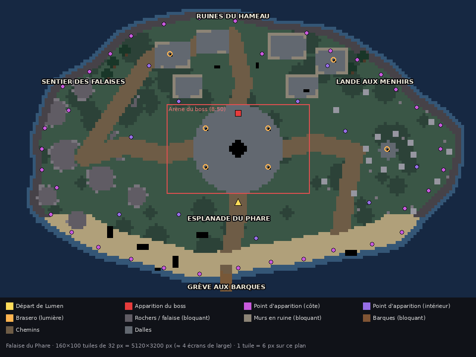

# Carte « Falaise du Phare » (MVP)

Carte unique du MVP de **Lumen, le dernier phare**. Elle est conçue pour Phaser 3 et l'éditeur Tiled.



## Fichiers

| Fichier | Rôle |
|---|---|
| `falaise_du_phare.tmj` | La carte Tiled (JSON). Le tileset est intégré, parce que Phaser 3 ne lit pas les tilesets externes |
| `tileset_falaise_etendu.png` | **Tileset utilisé par la carte** : tuiles 1 à 28 du DA (PR #8), plus les bordures 29 à 52 dérivées automatiquement de ses tuiles, plus la tuile 53 transparente (collision invisible) |
| `tileset_falaise_provisoire.png` | Même grille en couleurs unies (repli si les assets du DA manquent) |
| `apercu_falaise_du_phare.png` | Plan annoté |
| `tools/generer_carte.py` | Générateur (Python + Pillow + numpy). Pour modifier la carte, on édite le script et on le relance. Le résultat est toujours le même. Option `--assets <dossier>` (par défaut `public/assets/` du dépôt) pour lire le tileset et les sprites du DA |

## Dimensions

- 160 × 100 tuiles de 32 px, soit 5 120 × 3 200 px. Ça fait environ 4 écrans de large et 4,4 de haut pour une fenêtre de 1 280 × 720.
- La carte est **fermée** : la mer l'entoure. Au nord, à l'est et à l'ouest, des falaises bloquent le passage. Au sud, une grève de sable est praticable.
- 87 % de l'île est praticable.

## Zones

| Zone | Rôle en jeu |
|---|---|
| **Esplanade du phare** (centre) | Départ, et arène du boss : un cercle de dalles autour du phare éteint, avec 4 braseros |
| **Ruines du hameau** (nord) | 6 maisons en ruine, chacune avec 2 brèches de 4 tuiles. Ce sont des couloirs où canaliser les hordes |
| **Sentier des falaises** (ouest) | Gros rochers et couloirs de 4 à 6 tuiles. C'est la zone la plus étroite, risquée mais efficace pour les armes de zone |
| **Lande aux menhirs** (est) | Grand espace ouvert avec un cromlech au centre. Idéal pour tourner en rond (kiting) |
| **Grève aux barques** (sud) | Sable, barques échouées et un ponton qui avance dans la mer |

Six chemins de terre relient les zones. Le générateur garantit qu'aucun obstacle ne les coupe.

## Couches

**Couches de tuiles** (dans l'ordre d'affichage) :

1. `sol` : eau, sable, herbe, chemins, dalles, falaise. L'eau et la falaise **bloquent**.
2. `deco` : décor non bloquant (fleurs, cailloux, filets…).
3. `obstacles` : tout ce qui bloque (rochers, murs, menhirs, barques, pins, phare, caisses, braseros).
4. `dessus` : affiché **au-dessus** des personnages (feuillage des pins). Propriété `depth = 100`.
5. `obstacles_tuiles` (**cachée**) : la version « tout en tuiles » des obstacles (phare, barques, braseros, caisses). Elle sert de repli si on ne veut pas des sprites.

**Couches d'objets :**

| Couche | Type d'objet | Contenu |
|---|---|---|
| `joueur` | `player_start` | Départ de Lumen, juste au sud de l'esplanade |
| `apparitions` | `spawn` | 47 points (36 le long de la côte, 11 à l'intérieur). Propriétés `origine` et `zone` |
| `boss` | `boss_spawn`, `boss_arena` | Point d'apparition de La Marée. Rectangle d'arène de 48 × 30 tuiles (1 536 × 960 px), `fermeture_sec = 530` |
| `lucioles` | `firefly_zone` | 5 rectangles où faire apparaître les lucioles au sol, avec un `poids` (l'esplanade vaut 3) |
| `zones` | `zone` | Les 5 zones nommées (statistiques, ambiance sonore, nom affiché) |
| `decors` | `prop` | 36 sprites du DA posés en objets image : phare, 7 barques, 7 braseros, 8 caisses, 13 rochers. Propriétés `key` (clé du manifest), `originX`, `originY`, `angle`, `scale`, `flipX`, `depth` |
| `lumieres` | `light` | 7 braseros (`rayon_px`, `couleur`, `intensite`) et le phare (`allume_a_sec = -1` : il s'allume à la victoire) |

## Code Phaser minimal

```js
// preload
this.load.tilemapTiledJSON('falaise', 'maps/falaise_du_phare.tmj');
this.load.image('tiles_falaise', 'maps/tileset_falaise_etendu.png');

// create
const map = this.make.tilemap({ key: 'falaise' });
const ts = map.addTilesetImage('falaise', 'tiles_falaise');   // 'falaise' = nom du tileset dans le .tmj
const sol = map.createLayer('sol', ts);
map.createLayer('deco', ts);
const obstacles = map.createLayer('obstacles', ts);
map.createLayer('dessus', ts).setDepth(100);
sol.setCollisionByProperty({ collides: true });
obstacles.setCollisionByProperty({ collides: true });
this.physics.add.collider(lumen, [sol, obstacles]);
this.physics.add.collider(ennemis, [sol, obstacles]);

// décors du DA (sprites props/ chargés via manifest.props)
for (const o of map.getObjectLayer('decors').objects) {
  const p = Object.fromEntries(o.properties.map(q => [q.name, q.value]));
  this.add.image(o.x, o.y, p.key).setOrigin(p.originX, p.originY)
    .setAngle(p.angle).setScale(p.scale).setFlipX(!!p.flipX).setDepth(p.depth);
}
// trier les personnages par y : sprite.setDepth(sprite.y) à chaque frame

const depart = map.findObject('joueur', o => o.type === 'player_start');
const spawns = map.getObjectLayer('apparitions').objects;
this.physics.world.setBounds(0, 0, map.widthInPixels, map.heightInPixels);
this.cameras.main.setBounds(0, 0, map.widthInPixels, map.heightInPixels);
```

Je l'ai testé dans Chromium sans écran avec Phaser 3.80.1, avec le tileset et les sprites du DA : la carte se charge, les couches et les décors s'affichent, et les collisions sont actives.

## Règles d'utilisation pour le Développeur

- **Choix du point d'apparition** (issue #11) : prendre un point `spawn` **hors de la vue de la caméra** (plus de 64 px au-delà du bord, en pixels monde, zoom compris) et à moins de `distMax` de Lumen, avec `distMax = max(1100, demiDiagonaleVue + 300)`. `demiDiagonaleVue = Math.hypot(cam.worldView.width, cam.worldView.height) / 2`. Ainsi la règle marche sur tous les écrans, même en 2560×1440. S'il n'y a aucun point valide, prendre le plus proche hors caméra. Les vagues en cercle (`ring`) se placent autour de Lumen, et on ignore les positions qui tombent sur une tuile bloquante.
- **Déplacement des ennemis** : avec 200 ennemis et des obstacles, une poursuite en ligne droite reste coincée. Je recommande un **champ de flux** (flow field) : un parcours en largeur sur la grille de tuiles depuis la position de Lumen, recalculé 4 fois par seconde (16 000 cases, c'est rapide). Chaque ennemi suit la case voisine la plus proche de Lumen.
- **Taille des ennemis** : tous les points d'apparition sont accessibles à un ennemi de 2 × 2 tuiles (l'Ombre lourde, les mini-boss). C'est vérifié par le script.
- **Arène du boss** : à 8:50, un mur de brume infranchissable se forme sur le contour de `arene_boss`. La caméra peut rester libre. L'arène fait 1 536 × 960 px de monde : avec le zoom de la caméra (issue #4), elle reste plus grande que la vue sur tous les écrans. Les vagues de La Marée **traversent** les obstacles : le phare ne sert pas d'abri.
- **Lucioles au sol** : toutes les 10 s, tirer une zone `firefly_zone` selon son poids, puis une position praticable dans cette zone, entre 300 et 600 px de Lumen.

## Bordures et décors en sprites

- **Bordures automatiques** : le générateur pose une tuile de transition partout où l'herbe touche le sable ou un chemin, et où le sable touche l'eau. Ça fait 560 tuiles. Quand la matière voisine touche 3 côtés, ou 2 côtés opposés, la tuile prend directement cette matière. Les bordures 29 à 52 sont fabriquées à partir des tuiles du DA (frange ondulée de 8 à 11 px). Si le DA dessine les siennes aux mêmes positions dans `tileset_falaise.png`, le générateur les reprend telles quelles.
- **Sprites** : le phare (échelle 1,25), les barques, les braseros et les caisses sont des objets image. Sous eux, la couche `obstacles` porte la tuile 53 (transparente, mais bloquante). La collision du phare est un disque de 2,6 tuiles de rayon, à la largeur du pied du sprite. Les barques font 4 × 2 tuiles, ou 2 × 4 pour celles tournées de 90°.
- **Gros rochers** : les tuiles `rocher_gros` du DA restent **visibles**, et 13 sprites `rocher_grand` sont posés par-dessus pour le relief. J'ai essayé de remplacer les amas entiers par des sprites. Ça donnait soit un motif répétitif en « boîte à œufs », soit des murs invisibles sur les bords irréguliers. Le mélange est plus lisible pour le joueur.

## Contrat de tuiles (pour le DA)

Le DA peut redessiner librement l'image du tileset, à une condition : **garder la même grille** (8 colonnes, tuiles de 32 px) et **le même ID pour chaque tuile**. La carte n'a alors rien à changer. Pour ajouter des bordures automatiques (herbe→sable, etc.), on peut ajouter des tuiles à la suite et les placer dans Tiled, ou demander au Level designer de les gérer dans le générateur.

| ID | Nom | Bloque | Couche |
|---|---|---|---|
| 1 | eau_profonde | oui | sol |
| 2 | eau_ecume | oui | sol |
| 3 | sable | | sol |
| 4 | herbe | | sol |
| 5 | herbe_sombre | | sol |
| 6 | chemin_terre | | sol |
| 7 | dalles | | sol |
| 8 | falaise | oui | sol |
| 9 | planches | | sol |
| 10 | fleurs | | deco |
| 11 | cailloux | | deco |
| 12 | filet_algues | | deco |
| 13 | herbe_haute | | deco |
| 14 | flaque | | deco |
| 15 | os_epave | | deco |
| 16 | (réserve) | | deco |
| 17 | rocher_petit | oui | obstacles |
| 18 | rocher_gros | oui | obstacles |
| 19 | mur_ruine | oui | obstacles |
| 20 | menhir | oui | obstacles |
| 21 | barque | oui | obstacles |
| 22 | tronc_pin | oui | obstacles |
| 23 | phare_base | oui | obstacles |
| 24 | caisse | oui | obstacles |
| 25 | brasero | oui | obstacles |
| 26 | feuillage_pin | | dessus |
| 27 | phare_haut | | dessus |
| 28 | (réserve) | | dessus |
| 29-36 | herbe_sable_n, _e, _s, _o, _ne, _se, _so, _no | | sol |
| 37-44 | herbe_chemin_n … _no (même ordre) | | sol |
| 45-52 | sable_ecume_n … _no (même ordre) | | sol |
| 53 | collision_invisible (transparente) | oui | obstacles |
| 54-56 | (réserve) | | sol |

Le tileset passe ainsi à 56 cases (8 colonnes × 7 lignes). Dans chaque série, la tuile porte le sol de base, et la frange de la matière voisine se trouve du côté indiqué : `_n` = frange en haut, `_ne` = coin haut-droite, etc.

Remarque pour le DA : dans `props/phare.png`, la lanterne du phare est allumée. Or, dans l'histoire, le phare est éteint jusqu'à la victoire. Il faudrait une variante `phare_eteint` (le jeu bascule sur `phare` à la victoire). La clé est déjà prévue côté carte : il suffit de changer `key`.
